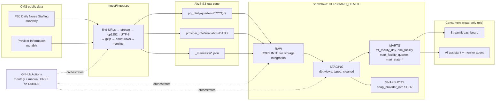

# Nursing Home Staffing Data Pipeline

**CMS PBJ → AWS S3 → Snowflake → dbt → GitHub Actions**

An automated ELT pipeline that loads federal nursing-home staffing and quality data every quarter, checks it against the source files, and publishes clean, tested tables for a staffing dashboard and AI tools. Nobody has to re-run a notebook.

This is the data engineering layer behind the [Nursing Home Staffing Dashboard](https://github.com/jlredding/clipboard_health_dashboard) and the [original analysis](https://github.com/jlredding/clipboard_health).



## Problem

My first version of this project answered staffing questions for a single quarter (Q2 2024) with a Colab notebook and two exported CSVs. That works once. A staffing operations team needs the same numbers every quarter, joined to star ratings and ownership, and available to every tool that uses them. The notebook approach also hid a real bug: an Excel export silently cut the file off at 1,048,575 rows. This pipeline makes the refresh automatic and makes data loss a failing test instead of something someone has to catch by eye.

## Data

| Source | Grain | Refresh | Size |
|---|---|---|---|
| [CMS Payroll-Based Journal (PBJ) Daily Nurse Staffing](https://data.cms.gov/quality-of-care/payroll-based-journal-daily-nurse-staffing) | facility × day | quarterly | ~1.3M rows per quarter |
| [CMS Provider Information](https://data.cms.gov/provider-data/dataset/4pq5-n9py) | facility | monthly | ~14,700 rows |

Known quality issues the pipeline handles: Windows-1252 encoding, zero-census days, director-of-nursing hours over 24 in a day, and about 20 facilities reporting under 0.5 hours per resident day (likely missing payroll data).

## How it works

1. **Ingest** (`ingest/ingest.py`): looks up each file in the CMS catalogs (no hard-coded URLs), streams it, converts Windows-1252 to UTF-8, gzips it to S3 partitioned by quarter, and writes a manifest with the source row count and checksum. Files that are already ingested are skipped, so re-runs are cheap.
2. **Load** (`load/load_snowflake.py`): `COPY INTO` Snowflake RAW through an S3 storage integration. Each partition is replaced inside one transaction, so a re-run never double-loads. An internal-stage fallback exists in case the S3 integration is unavailable.
3. **Transform** (`dbt/clipboard_health`): staging views clean and type the raw text, then marts build on top. `fct_facility_day` is incremental, so a new quarter only processes new rows.
4. **Test**: 16 dbt tests, including:
   - `assert_raw_rowcount_matches_manifest`: rows loaded must equal rows in the source file (this catches truncation like the Excel cutoff)
   - `assert_q2_2024_matches_da_project`: a regression test against the published dashboard numbers
   - grain, uniqueness, relationships, accepted values, and source freshness
5. **Orchestrate** (`.github/workflows/pipeline.yml`): runs monthly and on demand, using credentials stored as encrypted GitHub secrets. Every pull request runs the full pipeline on DuckDB, so broken SQL never reaches Snowflake.

The same dbt models run on DuckDB locally and in CI (`DBT_TARGET=dev`) and on Snowflake in production (`DBT_TARGET=prod`). Three small macros in `macros/cross_db.sql` cover the SQL dialect differences.

## Data model

| Model | Grain | Use |
|---|---|---|
| `fct_facility_day` | facility × day | daily HPRD, low-staffing days |
| `dim_facility` | facility | star ratings, ownership, beds, location |
| `mart_facility_quarter` | facility × quarter | weighted HPRD, contract staff share, quarter-over-quarter change |
| `mart_state_quarter` | state × quarter | state comparisons |
| `mart_state_day` | state × day | trend lines |
| `snap_provider_info` | facility × version | SCD Type 2 history of star ratings and ownership |

HPRD (hours per resident day) is calculated once, in dbt, as a weighted measure: total nurse hours ÷ total resident-days. Every consumer reads the same number instead of re-deriving it.

## Results

- **Runs in production on Snowflake:** 5 quarters (Q2 2024, Q3 2025 to Q2 2026) plus the latest Provider Information snapshot, **6.6M source rows**, loaded and verified with a row-count match on every file
- **Q2 2024 reconciles exactly with the published dashboard:** 3.30 national HPRD, 34% of facilities below 3.0 HPRD, 7.7% of hours from contract staff
- **Two years later (Q2 2026):** national HPRD rose to 3.38, the share of facilities below 3.0 fell to 30%, and contract staff share fell to 5.8%
- **24 dbt steps (7 models, 1 snapshot, 16 tests):** 23 pass, and 1 data-quality check deliberately warns instead of failing. It flags facility-days with negative hours or more than 24 nursing hours per resident, so suspect CMS records get reviewed instead of silently skewing averages.
- **Fast and cheap:** the dbt build on Snowflake takes about 22 seconds, the full GitHub Actions run about 2 minutes, on an X-Small warehouse that suspends after 60 seconds idle

## Tech stack

Python (requests, boto3) · AWS S3 · Snowflake · dbt Core · DuckDB · GitHub Actions · SQL · Mermaid

## Repo layout

```
ingest/       download from CMS, convert, gzip, write manifests
load/         COPY INTO Snowflake (or DuckDB for local runs)
snowflake/    one-time setup: database, schemas, roles, storage integration, RAW tables
dbt/          clipboard_health dbt project: staging, marts, snapshots, tests
config/       sources.yml: which CMS datasets and quarters to pull
docs/         architecture diagram
.github/      scheduled and PR workflows
```

## How to run

**Locally with DuckDB (no cloud account needed):**

```bash
git clone https://github.com/jlredding/clipboard_health_pipeline.git
cd clipboard_health_pipeline
pip install -r requirements.txt
make local          # ingest → DuckDB → dbt build (models + tests)
make docs           # optional: dbt docs site with the lineage graph
```

**On AWS + Snowflake:**

1. Run `snowflake/00_setup.sql`, `01_storage_integration.sql`, and `02_raw_tables.sql` once.
2. Set up AWS credentials with `aws configure` (stored in `~/.aws/credentials`, outside the repo).
3. Create a key pair for the Snowflake service user and register the public key:
   ```bash
   mkdir -p ~/.snowflake
   openssl genrsa 2048 | openssl pkcs8 -topk8 -inform PEM -out ~/.snowflake/rsa_key.p8 -nocrypt
   openssl rsa -in ~/.snowflake/rsa_key.p8 -pubout -out ~/.snowflake/rsa_key.pub
   ```
   ```sql
   alter user pipeline_svc set rsa_public_key = '<contents of rsa_key.pub without the header lines>';
   ```
4. Copy `.env.example` to `.env` and fill in your bucket, Snowflake account, and key path.
5. Run:

```bash
set -a; source .env; set +a
make prod           # ingest → S3 → Snowflake → dbt build
```

## What I learned

- **Reconcile in a test, not by eye.** The Excel truncation bug in my first version looked fine in every chart. A row-count test against the source manifest turns that kind of silent data loss into a failed build.
- **Land everything as text in RAW.** Loading raw columns as strings means a bad value in a new quarter never breaks the load. Typing and cleaning happen in dbt staging, where a failure is visible, tested, and easy to fix.
- **Cloud permissions are part of the pipeline.** The S3 storage integration failed with an AssumeRole error until the IAM trust policy included Snowflake's external ID. I kept an internal-stage fallback so a permissions problem doesn't block the whole pipeline.
- **Secrets never live in the repo.** AWS keys stay in the AWS CLI config, Snowflake logs in with a key pair (Snowflake no longer allows passwords for service users), and the scheduled run reads both from encrypted GitHub Actions secrets.

**Next steps:** move orchestration to Airflow or Dagster, add alerting when a test fails, and point the dashboard directly at the Snowflake marts.

## Contact

Jonathan Redding · San Antonio, TX · [LinkedIn](https://www.linkedin.com/in/YOUR-HANDLE) · [GitHub](https://github.com/jlredding)
