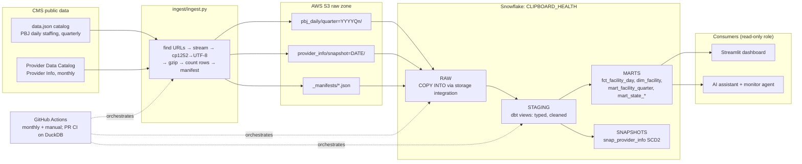

# Architecture

**Dev vs prod.** The same dbt models run on DuckDB (`DBT_TARGET=dev`, local and in PR CI) and on
Snowflake (`DBT_TARGET=prod`). Three small macros in `macros/cross_db.sql` cover the dialect differences.
